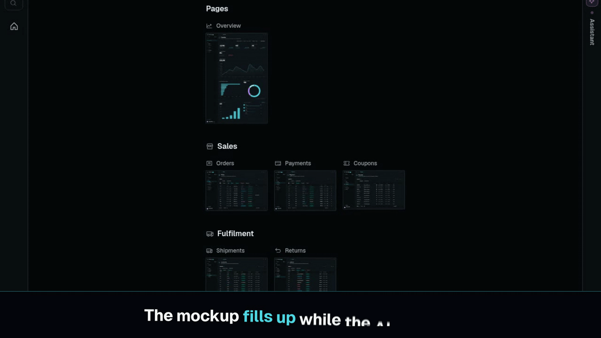
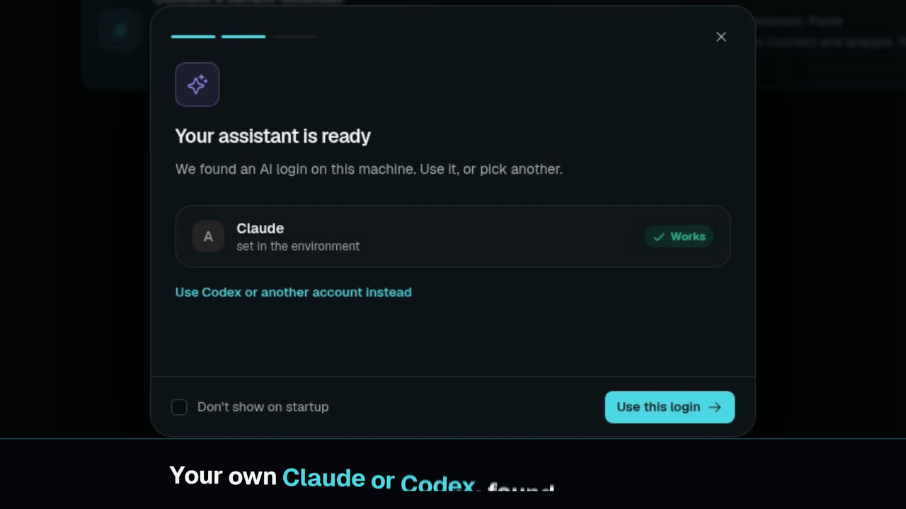
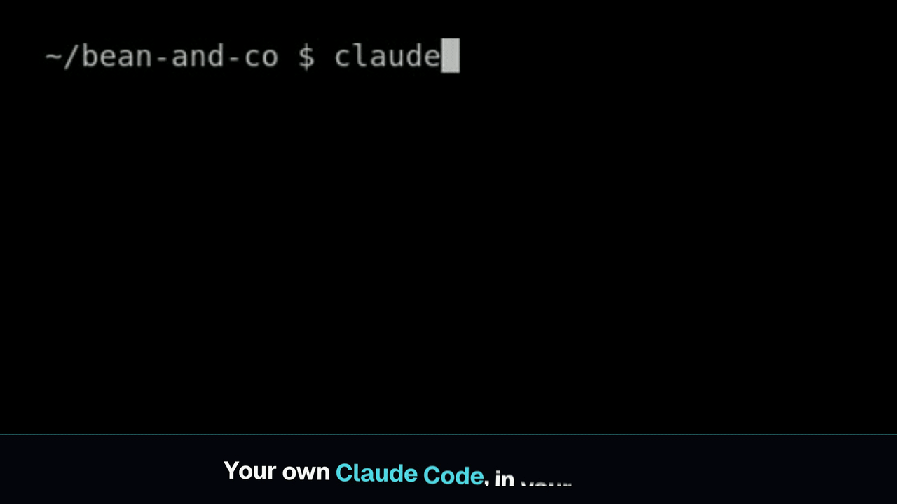

<a href="https://github.com/AntelopeJS/dms"></a>

<div align="center">

# `@antelopejs/dms-assistant`

<a href="https://www.npmjs.com/package/@antelopejs/dms-assistant"></a> <a href="./LICENSE"></a> <a href="https://discord.gg/g4pFt6eXqu"></a> <a href="https://dms.antelopejs.com/docs/modules/assistant"></a> <a href="https://github.com/AntelopeJS/dms"></a>

**A development assistant inside the [AntelopeJS DMS](https://github.com/AntelopeJS/dms) dashboard. Start from scratch or from a database you already run, iterate on a live mockup, then build the real pages.**

[Documentation](https://dms.antelopejs.com/docs/modules/assistant) · [All modules](https://github.com/AntelopeJS/dms#modules)

</div>



## What it does

The module is for development. With `NODE_ENV=production`, the backend starts no sidecar and the dashboard shows no assistant.

### Onboarding

The first time an owner opens the dashboard, the assistant's window opens on its own. It finds a Claude or Codex login on the machine, or signs you in, then asks where you start from:

- **Start from scratch**: describe the product in a few sentences, and the assistant drafts a mockup.
- **Start from an existing database**: paste a Postgres, MySQL/MariaDB or MongoDB connection string and press **Connect and analyse**. The assistant lists the tables and the screens it proposes, then you **Build directly** or **Generate a first mockup**. It sees your schema and counts, never the values in your rows.



### Mockups

A mockup is `mockups/<name>/spec.json` in your repo, drawn by the real DMS renderer on the `/mockup` page. You settle the dashboard there before any page is built:

- The mockup fills up while the AI writes it, page by page.
- A change is a save of the file, and the page redraws at once, with no typecheck and no reload. Blocks read sample data, so no table or query is wired yet.
- Pin a comment on any block, or on the page, and press **Resolve with AI**. The assistant applies the open comments and resolves them.
- Every change is a version you can preview or restore, and the **Mockups** page lists your mockups with how much of each is built.
- **Build it** writes the real pages as TypeScript, binds them to your data and checks each one against the mockup.

### Chat

- Docks a chat panel next to any page, with the page as context. `Ctrl` `Shift` `K` opens it.
- Runs a coding agent in a local sidecar. The agent is Claude Code by default, or OpenAI's Codex, and it reads the project, its loaded modules and their skills.
- Edits pages through the builder tools of the DMS MCP server in Safe mode, or writes code in Code mode. It then typechecks and shows the result live.
- Saves every turn that touches the project as a change set you can review, undo and redo.
- Adds an **Assistant** module for owners, with the **Settings**, **Changes** and **Activity** pages.

### From your own Claude Code or Codex

The mockup and the build are skills, so they also work from your terminal, without opening the dashboard. Install the `antelopejs` plugin from [AntelopeJS/agent-skills](https://github.com/AntelopeJS/agent-skills):

```bash
# Claude Code
claude plugin marketplace add AntelopeJS/agent-skills
claude plugin install antelopejs@antelopejs

# Codex
codex plugin marketplace add AntelopeJS/agent-skills
codex plugin add antelopejs@antelopejs
```

`ajs project dev` adds a `dms` server to the project's `.mcp.json` and `.codex/config.toml`, so your session gets the same builder, database and mockup tools as the dashboard's chat. Ask it to mock up an app, comment on the mockup at `/mockup?name=<name>`, then ask it to build it.



### Database connect flow

- Serves the routes behind **Start from an existing database** under `/api/builder/database`. By default they run only in development (`ajs project dev`), and every route requires a tenant owner.

The builder itself, its interface [`@antelopejs/interface-dms-builder`](https://www.npmjs.com/package/@antelopejs/interface-dms-builder) and its MCP server ship in `@antelopejs/dms`.


## Install

From the root of a project that already loads `@antelopejs/dms`, add the module with the AntelopeJS CLI:

```bash
ajs project modules add @antelopejs/dms-assistant
```

## Configuration

The assistant's keys stay at the top level of the module's `config`. The database connect routes read one key, `builder.api.enabled`. The chat gets its builder tools from the DMS MCP server, so the `dms` module's `mcp.backendUrl` points the server's bridge at the same origin.

```ts fragment
// antelope.config.ts
"dms-assistant": {
  source: { type: "package", package: "@antelopejs/dms-assistant" },
  config: {
    backendUrl: "${@api.API_LOCAL_BASE_URL}",
  },
},
dms: {
  config: {
    mcp: { backendUrl: "${@api.API_LOCAL_BASE_URL}" },
  },
},
```

| Key                       | Default                     | What it does                                                                                  |
| ------------------------- | --------------------------- | --------------------------------------------------------------------------------------------- |
| `backendUrl`              | `http://localhost:5010`     | The origin the sidecar reaches the backend on. Point it at the origin the `api` module reserved. |
| `builder.api.enabled`     | `true` in development only  | Turns the database connect routes on or off, whatever the mode.                                |

Claude Code runs with its own credentials, either its login or `ANTHROPIC_API_KEY` in the backend's environment. Codex runs on your ChatGPT plan and uses no OpenAI API key. To use Codex, install `@openai/codex` at the version that `peerDependencies` pins, then press **Sign in with ChatGPT** in **Assistant** › **Settings**. On a DMS that runs on another machine, finish the sign-in with **Paste the return address**.

Start the backend with `ajs project dev -w`, then the frontend with `ajs dms dev`. Sign in as an owner. Press `Ctrl` `Shift` `K` (`⌘` `⇧` `K` on macOS) for the assistant. To start the backend without the sidecar, set `DMS_ASSISTANT=0`.

## Requirements

<!-- antelopejs-docs-compat:start -->

| Package                             | Supported                  | Tested with                |
| ----------------------------------- | -------------------------- | -------------------------- |
| `@antelopejs/agent-skills`          | `>=0.8.2 <0.9.0`           | `0.8.2`                    |
| `@antelopejs/dms`                   | `0.21.4-next.976.g78176ed` | `0.21.4-next.976.g78176ed` |
| `@antelopejs/interface-api`         | `>=0.3.3 <0.4.0`           | `0.3.3`                    |
| `@antelopejs/interface-core`        | `>=0.5.1 <0.6.0`           | `0.5.1`                    |
| `@antelopejs/interface-dms`         | `>=0.14.6 <0.15.0`         | `0.14.6`                   |
| `@antelopejs/interface-dms-builder` | `0.6.2-next.975.g07fb6f8`  | `0.6.2-next.975.g07fb6f8`  |

<!-- antelopejs-docs-compat:end -->

The module needs a DMS backend in a release that implements the `@antelopejs/interface-dms` range in the table. The dashboard needs an `@antelopejs/dms-frontend` renderer in the range that `engines["@antelopejs/dms-frontend"]` of `frontend-vue/package.json` declares. The `ajs dms` CLI refuses to build the module with a renderer outside that range. The database connect routes need an API provider, such as `@antelopejs/api`.

## Documentation

- [Introduction](https://dms.antelopejs.com/docs/modules/assistant/introduction)
- [Installation](https://dms.antelopejs.com/docs/modules/assistant/installation)
- [Onboarding](https://dms.antelopejs.com/docs/modules/assistant/onboarding): connect Claude or Codex, then start from scratch or from a database
- [Mockups](https://dms.antelopejs.com/docs/modules/assistant/mockups): draft the pages, comment on them, and build them
- [Configuration](https://dms.antelopejs.com/docs/modules/assistant/configuration), with the agent providers, Codex, Safe mode, the chat's MCP servers and remote access
- [Usage](https://dms.antelopejs.com/docs/modules/assistant/usage/chat)
- [Extending](https://dms.antelopejs.com/docs/modules/assistant/extending)
- [FAQ](https://dms.antelopejs.com/docs/modules/assistant/faq)
- [Database connection](https://dms.antelopejs.com/docs/modules/assistant/database-connection): the routes that connect an existing database
- [Builder](https://dms.antelopejs.com/docs/interfaces/builder/introduction), in the DMS docs: the operations behind the builder tools

The guide's sources live in [`docs/`](./docs). The package ships its agent skills in [`skills/`](./skills): `dms-assistant` and `dms-assistant-code-mode`. `antelopeJs.skills` declares them. The assistant loads them into its agent after the DMS workflow skills of `@antelopejs/agent-skills`.

## Contributing

Read [CONTRIBUTING.md](./CONTRIBUTING.md) before you open a pull request.

One install from the repository root installs the backend, the shipped Vue frontend and the sidecar. Each of the three keeps its own lockfile. The playground is separate and needs its own install for local development. The builds use the installed dependencies and do not install them again.

```bash
pnpm install --frozen-lockfile
pnpm --dir playground install --frozen-lockfile --ignore-workspace
pnpm build
pnpm build:sidecar
pnpm dev                # playground backend
pnpm frontend:dev       # dashboard, in a second terminal
pnpm run checks         # typecheck, lint, format, knip, node tests, size, suppressions, sync
pnpm test:frontend      # the assistant and builder Vue unit suites
pnpm --dir sidecar test # the sidecar suites
```

<details>
<summary>Repository notes</summary>

- The backend lives in `src/`, the database connect routes in `src/builder/`. They call the operations of `@antelopejs/dms` through `@antelopejs/interface-dms-builder`. `construct()` parses the config and constructs the builder part, which mounts `/api/builder/database` when it is on.
- The module registers one frontend, `frontend-vue`, through `AddFrontendModule` with the Vue renderer. The registration also carries the builder's `dmsBuilder.enabled` option, `true` only when the builder is on. The chat panel, `DmsAssistantChatPanel`, is a docked side panel (`registerSidePanel`); its code is under `frontend-vue/app/chat`. `frontend-vue/builder` holds no components: only the client and types of the builder's database routes, which the database connect flow uses. The renderer bundles the icons it finds in `.vue` files, so an icon name belongs in the component that shows it.
- To build and typecheck the Vue source, run `pnpm --dir frontend-vue verify-source`, or set `DMS_FRONTEND_WORKSPACE` to a generated Inertia workspace that includes this module and run `pnpm --dir frontend-vue build` and `pnpm --dir frontend-vue typecheck`.
- `pnpm test:node` builds once, then runs every suite in `tests/` and `tests/builder/` except the sidecar build smoke test (`pnpm test:sidecar-smoke`). `DMS_PREBUILT=1` skips the build when `dist/` is fresh, as in CI. The opt-in Codex acceptance suite runs with `CODEX_ACCEPTANCE=1 pnpm --dir sidecar test:acceptance`.

</details>

## Part of AntelopeJS DMS

This module installs into [AntelopeJS DMS](https://github.com/AntelopeJS/dms), the open-source back office. Every module adds its pages to the same dashboard, behind the same sign-in and roles.

<!-- antelopejs-dms-modules:start -->

| Module                                                           | What it adds                                                                             |
| ---------------------------------------------------------------- | ---------------------------------------------------------------------------------------- |
| [`dms-assistant`](https://github.com/AntelopeJS/dms-assistant)   | An assistant chat in the dashboard and its onboarding, on your own Claude Code or Codex  |
| [`dms-database`](https://github.com/AntelopeJS/dms-database)     | Schemas, relation diagrams, a data browser and a query console                           |
| [`dms-api`](https://github.com/AntelopeJS/dms-api)               | API health, request logs, per-route statistics and a request tester                      |
| [`dms-automation`](https://github.com/AntelopeJS/dms-automation) | Node-graph automations on schedules, webhooks and DMS events, with a trace for every run |
| [`dms-mailing`](https://github.com/AntelopeJS/dms-mailing)       | E-mail templates in a block editor, versions, a send log and delivery metrics            |
| [`dms-lang`](https://github.com/AntelopeJS/dms-lang)             | Translation coverage, a translation matrix and a translation queue                       |
| [`dms-media`](https://github.com/AntelopeJS/dms-media)           | A media library with folders, per-folder permissions, image sizes and light editing      |
| [`dms-saas`](https://github.com/AntelopeJS/dms-saas)             | Self-service sign-up, plans that gate features, and Stripe billing                       |
| [`dms-marketing`](https://github.com/AntelopeJS/dms-marketing)   | Traffic, conversion funnels with A/B splits and click heatmaps, without cookies          |
| [`dms-frontend`](https://github.com/AntelopeJS/dms-frontend)     | The `ajs dms` CLI, the Vue renderer and the SDK every frontend module builds on          |

<!-- antelopejs-dms-modules:end -->

## License

[Apache-2.0](./LICENSE)
