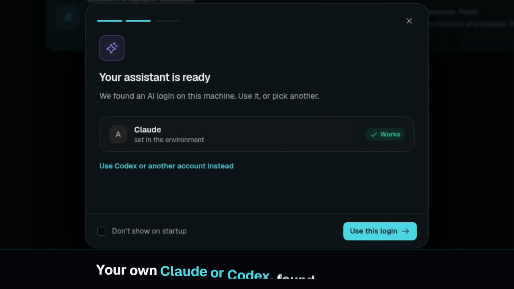

`@antelopejs/dms-assistant` adds an AI assistant to the AntelopeJS DMS dashboard while you develop. You describe the back office you need, or connect a database you already run. The assistant draws a mockup of the pages, you comment on it, and it builds the real pages in your project. After that, you open the chat on any page and ask for a change. Every turn that changes the project becomes a change set that you can review and undo.



## It runs on your own Claude or Codex plan

The assistant drives Claude Code or Codex on your machine, in the project folder. The first time an owner opens the dashboard, the assistant's window looks for a Claude or Codex login on the machine. If it finds none, it signs you in. AntelopeJS bills nothing. [Onboarding](/docs/modules/assistant/onboarding) walks through that first run.

::tip
**Using your own Claude Code or Codex instead of the chat?** Install the `antelopejs` plugin. Your agent then gets the same skills as the assistant: mockups, page building, and connecting an existing database.

```bash [Claude Code]
claude plugin marketplace add AntelopeJS/agent-skills
claude plugin install antelopejs@antelopejs
```

```bash [Codex]
codex plugin marketplace add AntelopeJS/agent-skills
codex plugin add antelopejs@antelopejs
```

`ajs project dev` writes the `dms` MCP server into the project's `.mcp.json` and `.codex/config.toml`, so the agent also gets the builder, database and mockup tools. [Install the plugin](/docs/ai-and-claude-code/install) covers the rest, such as trusting the plugin's hooks in Codex. Approvals, Safe mode, Changes and Activity belong to the dashboard chat, so they do not apply in your own session.
::

## From an idea to built pages

A project usually goes through four steps:

1. **Start.** The onboarding window starts from scratch, from a few sentences about your product, or from a database. For a database, the assistant reads the schema and the row counts, never the values in your rows, and proposes the screens.
2. **Mock up.** The assistant writes a mockup to `mockups/<name>/spec.json`. The dashboard draws it with the real DMS blocks while the assistant writes it. See [Mockups](/docs/modules/assistant/mockups).
3. **Review and build.** You pin comments on the mockup and click **Resolve with AI** until it looks right. **Build it** then writes the pages as TypeScript and checks each page against the mockup.
4. **Change.** From any page, you ask the [chat](/docs/modules/assistant/usage/chat) for a change, then review or undo it on the [Changes](/docs/modules/assistant/usage/changes) page.

::card-group
  :::card{title="Onboarding" icon="i-lucide-door-open" to="/docs/modules/assistant/onboarding"}
  Connect an AI login, then start from scratch or from a database.
  :::

  :::card{title="Mockups" icon="i-lucide-layout-template" to="/docs/modules/assistant/mockups"}
  Draft the pages, comment on them, and build them.
  :::

  :::card{title="Chat" icon="i-lucide-message-square" to="/docs/modules/assistant/usage/chat"}
  Ask for a change from any page and answer the assistant's requests.
  :::

  :::card{title="Changes" icon="i-lucide-git-compare" to="/docs/modules/assistant/usage/changes"}
  Review the diff of each change set, then undo or redo it.
  :::
::

## Safe mode and Code mode

Each conversation has a scope that decides what the agent may change:

- **Safe mode** changes pages, tables and queries only through the builder tools of the `dms` MCP server. Each change typechecks before it is written, and the agent cannot edit files or run commands. Safe mode is the default.
- **Code mode** also lets the agent edit any project file and run commands, within the approval mode you chose. Use it for custom logic that the builder tools cannot express.

Keep Safe mode unless you need custom code. A builder tool refuses a change that does not compile, so a wrong edit fails in the chat and not in your build.

## The assistant runs beside your backend

The module starts a sidecar, a local agent server that runs as a child process of the backend and listens on `127.0.0.1` only. The sidecar runs Claude Code or Codex in the project folder. The browser never talks to the sidecar directly. The chat goes through the DMS frontend server to the backend, then to the sidecar. The assistant therefore works wherever the dashboard does, over a LAN, Tailscale, an SSH tunnel or a reverse proxy.

The agent loads the DMS workflow skills of `@antelopejs/agent-skills` and the skills of every loaded module. It works with the tools of two MCP servers, which [Where the chat's tools come from](/docs/modules/assistant/configuration#where-the-chats-tools-come-from) lists.

## It exists in development only

With `NODE_ENV=production`, the backend starts no sidecar, and a sidecar you start yourself exits. Only the development frontend shows the assistant, and only to a signed-in owner. The assistant's routes are reserved to owners too. Only the owner supplies the URL of a database, as [Only the owner supplies a database URL](/docs/modules/assistant/database-connection#only-the-owner-supplies-a-database-url) explains.
