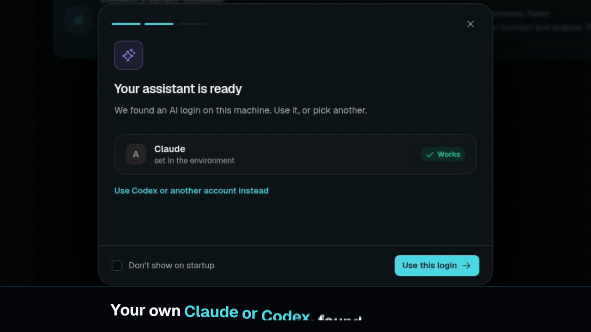
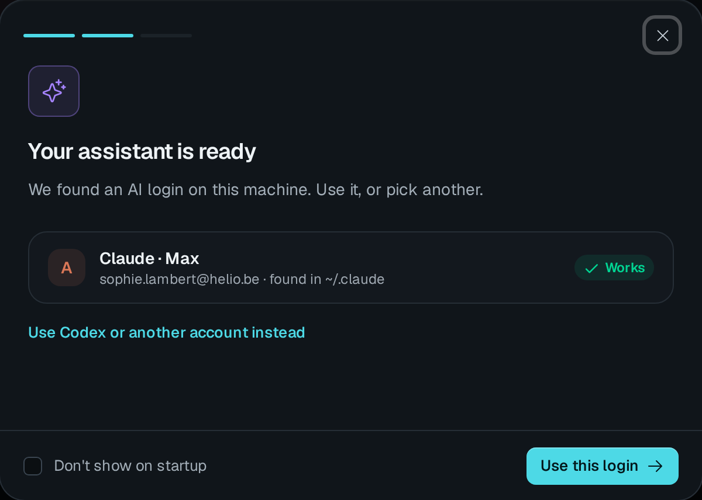
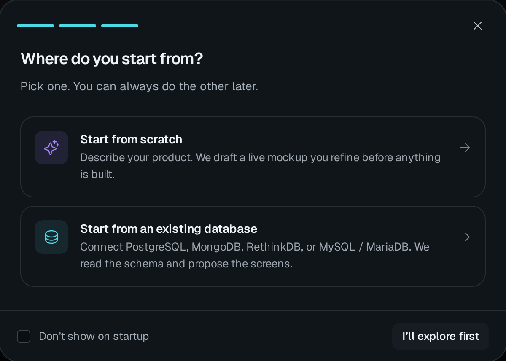
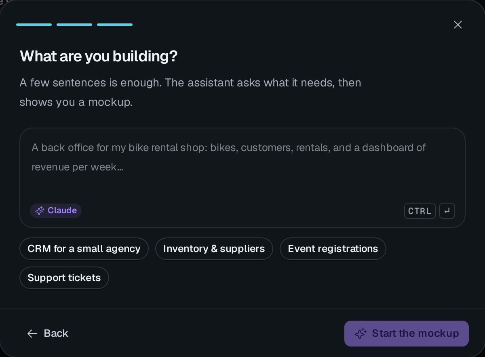
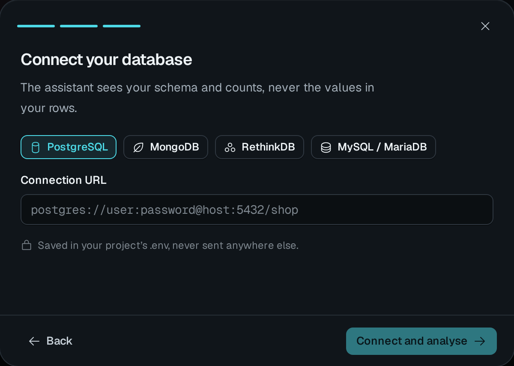

The first time an owner opens the dashboard in development, the assistant opens its onboarding window. It first connects the assistant to an AI login, then asks where you start from.

## Connect Claude or Codex

The window first looks for a login on the machine.

- **If it finds one**, the window reads **Your assistant is ready** and shows the login, such as **Claude · Max** and the account's email. Click **Use this login**. To pick another login, click **Use Codex or another account instead**.
- **If it finds none**, the window reads **Let's build your back office**. Click **Get started**, then pick **Claude** or **Codex** under **Which AI do you use?**.

The assistant checks these places, in this order:

1. For Claude, a credential in the backend's environment: `CLAUDE_CODE_OAUTH_TOKEN`, `ANTHROPIC_API_KEY` or `ANTHROPIC_AUTH_TOKEN`. A login from the environment always wins.
2. For Claude, a token you saved from this window.
3. For Claude, the login of the Claude Code CLI, in `~/.claude`, or in `CLAUDE_CONFIG_DIR` when that variable is set.
4. For Codex, a ChatGPT sign-in you made from this window or from the Settings page.

### Sign in with Claude

1. Pick **Claude**, then click **Continue**.
2. Under **Run this in a terminal**, copy `claude setup-token` and run it.
3. Paste the token it prints, which starts with `sk-ant-`, under **Paste the token it prints**.
4. When the window reads **Connected**, click **Continue**, then **Choose a starting point**.

The window checks the token with Anthropic, then saves it on this machine, in `claude-auth.json` in the same folder as the ChatGPT sign-in. [Sign in with your plan](/docs/modules/assistant/configuration#sign-in-with-your-plan) lists that folder for each platform.

### Sign in with ChatGPT for Codex

1. Pick **Codex**, then click **Continue**.
2. Click **Continue with ChatGPT**. ChatGPT opens in a new tab.
3. Approve the request in ChatGPT, then come back. The window updates by itself.

If the DMS runs on another machine, ChatGPT sends your browser to an address that starts with `http://127.0.0.1` and does not load. Click **DMS running on another machine?**, paste that whole address, then click **Connect**.

Codex also needs the `codex` CLI at the version the module pins. [Enable Codex](/docs/modules/assistant/configuration#enable-codex) shows how to install it.

## Choose where you start

Once the login works, the window asks **Where do you start from?**.

You can do the other path later. To close the window and look around first, click **I'll explore first**.

### Start from scratch

1. Click **Start from scratch**.
2. Under **What are you building?**, describe your product in a few sentences, or click a suggestion such as **CRM for a small agency**.
3. Click **Start the mockup**.

The window closes and the chat opens with your description as its first message. The assistant asks the questions it needs, then drafts a mockup. [Mockups](/docs/modules/assistant/mockups) covers what to do with it.

### Start from an existing database

The assistant reads the schema and the row counts of your database, never the values in your rows.

1. Click **Start from an existing database**.
2. Under **Connect your database**, pick the engine: **PostgreSQL**, **MongoDB**, **RethinkDB** or **MySQL / MariaDB**.
3. Paste the **Connection URL**. The URL is saved in your project's `.env` and sent nowhere else.
4. Click **Connect and analyse**. The window checks that the server answers, that the account signs in, and what it may read and write. Then it reads the schema.
5. If the account can write, choose what the DMS may do under **What may the DMS do with this database?**: **Read only** or **Read and write**.
6. The window lists the tables with their row counts, and the **Screens we propose**. Untick the screens you don't need.
7. Click **Build directly** to create the pages now, or **Generate a first mockup** to draft them in the chat first.

**Build directly** maps the ticked screens into pages, then opens the first one. **Generate a first mockup** closes the window and starts a conversation that drafts a mockup of the ticked screens from the connected database.

If the project lacks the engine's driver package, **Connect and analyse** stops and shows the install command. Click **Copy the install command**, run it in the project folder, then click **Connect and analyse** again.

If the window says to restart the project, stop it and start it again with `ajs project dev -w`. Without `-w`, the project does not load the new connection.

[Database connection](/docs/modules/assistant/database-connection) lists what connecting a database writes into `antelope.config.ts` and `.env`.

## Open the window again

The window opens by itself on every dashboard load until the assistant has a working login and the project has content: a conversation, a mockup or a connected database. After that, it opens once each time the server starts. To stop it, tick **Don't show on startup**.

To open the window yourself, click the **Assistant** chip in the dashboard's widget dock. Once the project has content, the window opens on **Welcome back**. It lists your recent chats to **Resume**, your mockups and your databases, with **New: from scratch** and **Connect a DB** to start again.

A link to any dashboard page with `?assistant=connect` opens the window on the **Connect your database** form, after the AI step when no login works yet.
