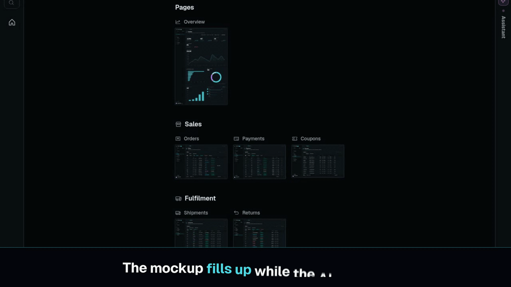
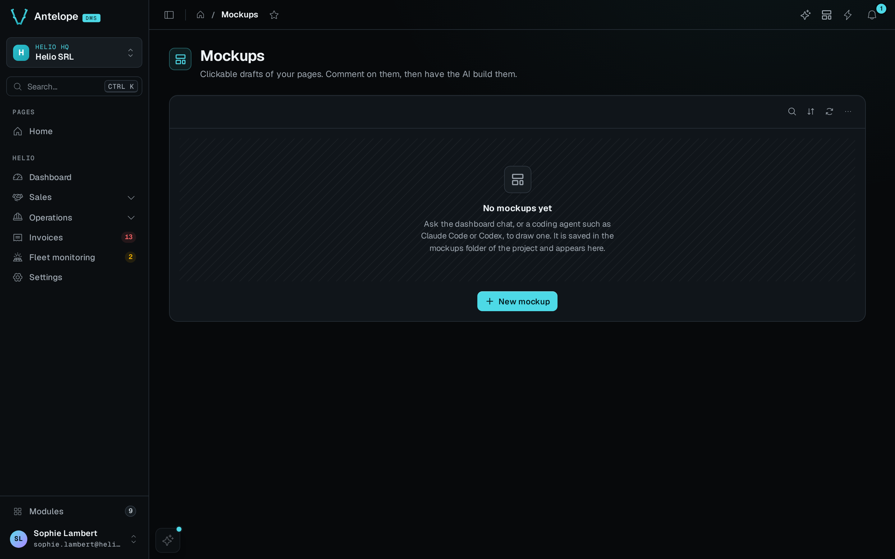
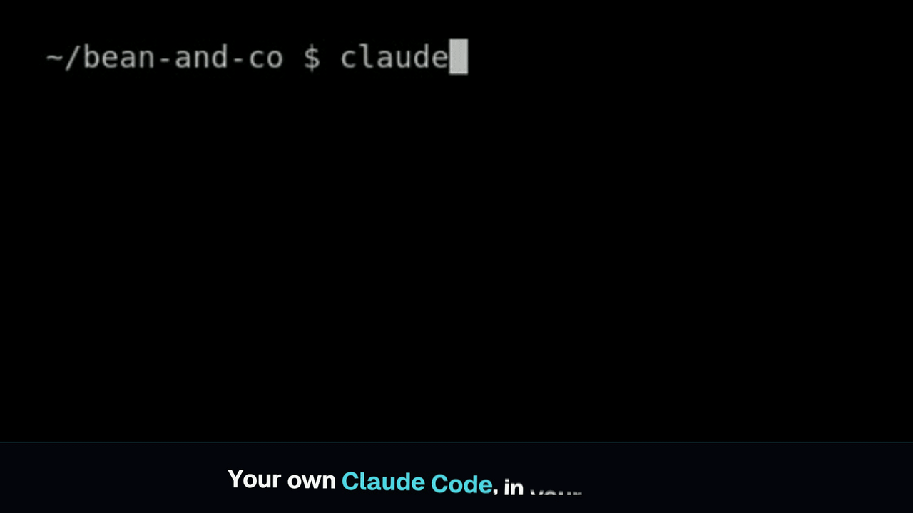

A mockup is a draft of one or more dashboard pages that you review before any code is written. The assistant writes it to `mockups/<name>/spec.json` in your project. The dashboard draws it with the real DMS blocks and sample data, so the mockup shows only what the DMS can build.

This page shows how to use mockups from the assistant. The DMS docs hold the reference: [Mockups](/docs/ai-and-claude-code/mockups) for the spec file, [Mockup viewer](/docs/ai-and-claude-code/mockup-viewer) for the viewer and the Mockups page, and [Mockup comments and overview](/docs/ai-and-claude-code/mockup-review) for comments.

## Ask for a mockup

Start a mockup in one of these ways:

- In the [onboarding window](/docs/modules/assistant/onboarding), click **Start the mockup** or **Generate a first mockup**.
- In the chat, ask for one, such as "Draft a mockup of an order desk with orders, customers and a revenue dashboard".
- On the **Mockups** page, click **New mockup**. The chat opens with "Draft a mockup of " in the composer. Finish the sentence and send it.

The assistant asks what it needs, then writes the spec. The viewer opens at `/mockup?name=<name>` and shows **The AI is writing the mockup…** until the first page arrives. Pages then appear as the assistant writes them. If you are on another page when the mockup is created, a toast offers **Open**.

## Comment on the mockup

1. In the viewer, click **Comment** in the top bar, or press `C`.
2. Click the block you want changed. A pin drops there.
3. Type what should change, then click **Comment**.

Add as many comments as you need. A bar at the bottom of the viewer counts the open comments.

## Resolve the comments with AI

Click **Resolve with AI** in the bar. The chat opens on a new conversation and the assistant applies each open comment to the spec, then resolves it. It ends with what it changed and the comments it left open, each with its question. While it works, the button reads **Resolving… ↗**, and a click on it opens that conversation.

To go back to an earlier draft, click **History**, pick a version, then click **Restore**. The current version stays in the history.

## Build the pages

When the mockup looks right, click **Build it** in the viewer. The assistant starts a new conversation that builds each page of the mockup:

1. It writes each page as a TypeScript `PageController`, through the builder tools where they can express the page.
2. It replaces the sample data with the project's real data.
3. It checks each built page against the mockup, fixes what differs, and checks again, at most three times.

The conversation ends with a link to each page it built, and names any page still failing its check. The build is a change set, so you can [undo it](/docs/modules/assistant/usage/changes).

## Follow your mockups on the Mockups page

The **Mockups** page, at `/mockups`, lists every mockup of the project as a card. Open it from its icon in the dashboard header. Like the viewer, it exists only in development and only for the owner.

Each card shows the mockup's stage:

| Stage | Meaning |
| --- | --- |
| **Draft** | The mockup was never built. |
| **2 of 5 pages built** | The build made some of the mockup's pages. |
| **Built** | The build made every page. |
| **Out of sync** | A built page changed after the build. **Update from page** updates the mockup from the changed page. |

A card also shows the open comments, where the mockup came from (the chat, Claude Code or Codex), and a link to each built page. Its **⋯** menu has **Open**, **Rename**, **Duplicate** and **Delete**. Deleting a mockup keeps the pages already built from it.

## Mockups from your own Claude Code or Codex

With the [`antelopejs` plugin](/docs/ai-and-claude-code/install), your own Claude Code or Codex session gets the same `dms-mockup` and `dms-mockup-build` skills and the `dms` mockup tools. The mockup it writes opens in the same viewer, and its card reads **from Claude Code** or **from Codex**.

When the assistant module is not installed, no assistant takes the request of **Resolve with AI** or **Build it**. The viewer shows the request under **Ask your AI** instead, for you to copy into your own agent.
