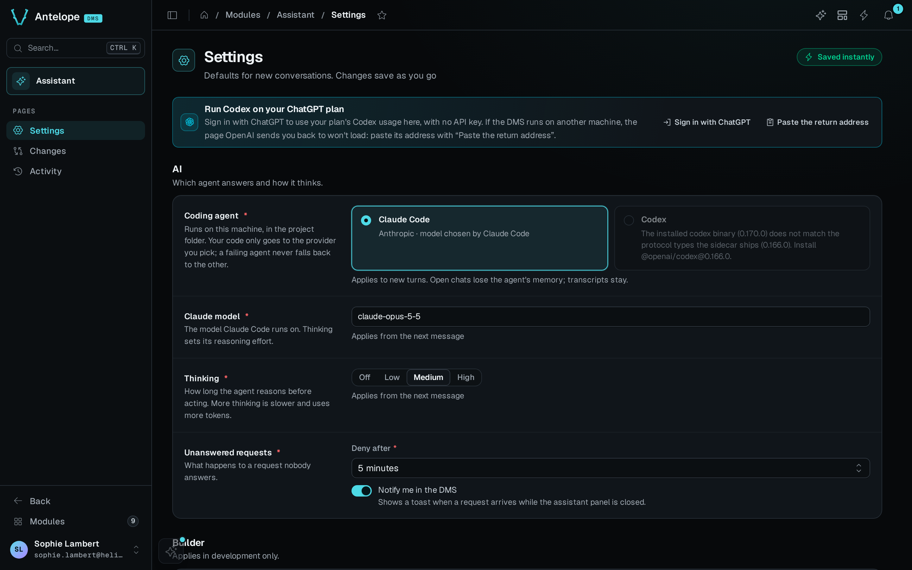

The Settings page, `/modules/ai/settings`, is the first page of the **Assistant** module. It holds the defaults of new conversations, and saves each change as you make it.

## Banners

A status banner at the top of the page appears when the assistant needs you. It shows the most pressing of these states:

| Banner | Action |
| --- | --- |
| **The assistant is offline** | **Restart assistant**. When the module's configuration or a production start turned the sidecar off, the banner says so, has no button, and the page shows no settings. |
| **The assistant's last turn failed**, with the error | **Open activity** |
| A count of requests waiting, such as **2 requests are waiting for you** | None |

A second banner shows the ChatGPT account that Codex runs on, while the sidecar runs:

| State | Banner and actions |
| --- | --- |
| Signed out | **Run Codex on your ChatGPT plan**, with **Sign in with ChatGPT** and **Paste the return address**. See [Sign in with your plan](/docs/modules/assistant/configuration#sign-in-with-your-plan). |
| Signed in | **Codex runs on the ChatGPT plan of** and your email, with **Sign out**. Signing out stops Codex in every DMS project of this machine until you sign in again. |

## AI

| Setting | Options |
| --- | --- |
| **Coding agent** | **Claude Code** (default) or **Codex**. When Codex is not set up on this machine, its option is off and says why. A change applies to new turns. Open chats lose the agent's memory and keep their transcript. |
| **Claude model** | The model Claude Code runs on, `claude-opus-5-5` by default. Applies from the next message. |
| **Thinking** | **Off**, **Low**, **Medium** (default) or **High**. Applies from the next message. |
| **Unanswered requests** | **Deny after** 5 (default), 15 or 30 minutes. **Notify me in the DMS**, on by default, shows a toast when a request arrives while the panel is closed. |

## Guard rails

The **Guard rails** card holds the settings that decide what the agent may do without asking you. They apply to new conversations.

| Setting | Options |
| --- | --- |
| **Default mode on Claude Code** | **Auto review** (default), **Ask first**, **Accept edits** or **Plan only** |
| **Default mode on Codex** | **Ask first** (default), **Accept edits** or **Plan only**. Codex has no Auto review. |
| **Safe mode** | On by default. Off, new conversations start in Code mode. Without the builder tools, the switch is off and says why. |
| **Always ask for** | **Deleting pages, tables, fields or queries**, locked on. **Adding or removing dependencies** and **Removing or moving Builder blocks**, on by default. |
| **Machine-local skills** | Off by default. On, the agent also loads the skills in `~/.claude/skills` on this machine. |

The default mode is stored for each agent, so switching the agent switches the default with it.

Only the **Guard rails** card can change these settings. It sends the header `x-dms-ui-assistant: 1` with each save, and `PUT /ai/settings` refuses a guard rail sent without it, with `403` and `code: "forbidden"`. A form, a dialog or a link on a page that the assistant built cannot set that header, so it cannot loosen a guard rail. When the sidecar or the DMS refuses a save, the control returns to its saved value.

## Approval modes

The approval mode decides which tool calls the agent makes without asking you. Each conversation can change it from the composer.

| Mode | Runs without asking | Asks you |
| --- | --- | --- |
| **Ask first** | Reads and builder calls | Every command, read-only ones such as `ls` included, and every change outside the builder |
| **Accept edits** | File edits, except dependency files, git hook files and project configuration files | Every command, and the edits it excludes |
| **Plan only** | Reads | Nothing. The turn changes nothing and ends on a plan. |
| **Auto review** (Claude Code only) | What a safety check approves among reads inside the project, routine file edits, web access and sub-agents. The check blocks the risky ones. | Every shell command and scheduled task, every read outside the project, every tool that acts outside the chat, and any tool a Claude Code update adds |

With Codex, **Accept edits** works as **Ask first**: the sandbox stays read-only in every mode, so Codex asks before every file edit and every command that writes.

When the model, your plan or a setting does not allow **Auto review**, the chat shows a notice and asks first instead. The [Activity](/docs/modules/assistant/usage/activity) page tells the safety check's decisions apart as **Allowed by Auto review** and **Blocked by Auto review**.

### What always asks

These calls ask in every mode, **Auto review** included:

| Call | Can you turn it off? |
| --- | --- |
| A builder call the `dms` MCP server holds: deleting pages, tables, fields, categories or queries, a database mapping that removes a page, a change of `antelope.config.ts` | No |
| Adding or removing a dependency: an edit of `package.json`, a lockfile, `pnpm-workspace.yaml`, `.npmrc`, `.pnpmfile.cjs`, `.yarnrc`, `.yarnrc.yml` or `bunfig.toml` | Yes, with **Adding or removing dependencies** |
| `builder_remove_block` and `builder_move_block` | Yes, with **Removing or moving Builder blocks** |
| An edit of a git hook file: anything inside a `.git` directory, `.husky/*`, a lefthook config file or `.pre-commit-config.yaml` | No |
| An edit of a project configuration file: `antelope.config.ts`, an `antelope.*.json` file or a file under `.antelope/` | No |

AntelopeJS core reads each module's configuration, the URL of each database included, from the project configuration files. A card for a git hook file or a project configuration file offers no rule, so the next edit asks again.

## Builder

| Setting | Options |
| --- | --- |
| **Undo history** | **Keep 7 days**, **Keep 30 days** (default) or **Keep 90 days**. Older change sets can no longer be undone. |

The Builder section applies in development only.

## Usage

The **Usage** section counts the tokens that conversations used over the last 14 days. **Tokens · last 14 days** charts them per day. **Last 14 days** gives the total, the number of conversations and the biggest conversation. Your provider bills the tokens. With Codex signed in with ChatGPT, they count toward your plan's limits.
